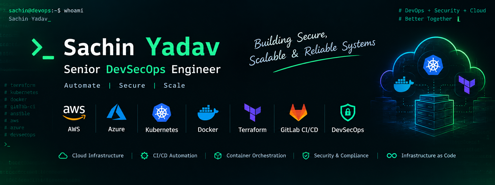

# Sachin Yadav
### Senior DevSecOps Engineer

**Cloud Infrastructure · CI/CD · Kubernetes · DevSecOps**

---

## About

DevOps / DevSecOps Engineer with 5+ years of experience automating CI/CD pipelines, managing cloud infrastructure, and deploying containerized applications. Focused on secure, scalable, and repeatable delivery using **AWS, Azure, Kubernetes, Terraform, Docker, and GitLab CI/CD**.

## Tech Stack

  

**DevSecOps:** SonarQube · Trivy · Fortify · OWASP Dependency-Check · JFrog Xray  
**Platforms:** Amazon EKS · OpenShift · JFrog Artifactory · Amazon ECR

## Featured Projects

| Project | Focus |
|---|---|
| **AWS Infrastructure with Terraform** | Reusable IaC modules and cloud environment provisioning |
| **Secure CI/CD Pipeline** | Automated builds, security scans, and container publishing |
| **Kubernetes on Amazon EKS** | Container deployments, health checks, scaling, and rollbacks |

*Project links will be added as repositories are published.*

## GitHub Analytics

  
  
  

## Certifications

AWS Certified Cloud Practitioner · Microsoft Azure Administrator Associate (AZ-104) · Azure Fundamentals (AZ-900)

---

  <a href="https://github.com/sachinashokyadav">GitHub</a> ·
  <a href="https://linkedin.com/in/sachin-yadav-20051999">LinkedIn</a> ·
  <a href="mailto:sachin.ashok.yadav18@gmail.com">Email</a>
   Automate. Secure. Scale.

